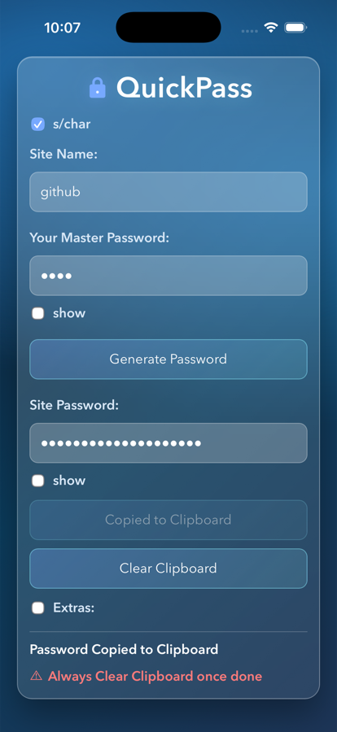

# QuickPass - App

A standalone, offline password generator for **Android and iOS**, built with **Tauri + React**.

QuickPass is deterministic: the same master password + site name + settings always produce the same output. Nothing is stored in a database or sent to a backend.
The password is derived on the fly using BLAKE2S and SHA-256.

Project repo: [brushtailmedia/quickpass-app](https://github.com/brushtailmedia/quickpass-app)

Download pre-built binaries from [Releases](https://github.com/brushtailmedia/quickpass-app/releases).



## What It Is

QuickPass originally started as a Python Tkinter desktop app which I have used privately for many years now. QuickPass App is the Android/iOS edition. The desktop edition lives at [brushtailmedia/quickpass-desktop](https://github.com/brushtailmedia/quickpass-desktop), and a standalone single HTML file version at [brushtailmedia/quickpass-standalone](https://github.com/brushtailmedia/quickpass-standalone).

- Local-first deterministic password generation
- No account system
- No cloud sync
- No server dependency

The app keeps its own password core in `src/core.js`.

## How It Works

1. You enter a **site name** (for example `github`, `github/work`, or `user@example.com`) and your **master password**.
2. Inputs are combined and expanded using repeated **BLAKE2S** hashing.
3. The expanded key is hashed with **SHA-256** (Web Crypto API in the webview runtime).
4. Bytes are encoded based on output mode:
   - No special chars mode
   - Limited special chars mode
   - Full special chars mode

## Output Options

| Option | Behavior |
|---|---|
| `s/char` off | Uses alphanumeric-safe output (derived from Base64 with `+` and `/` remapped) |
| `s/char` on + limited | Uses `abcdefghijklmnopqrstuvwxyzABCDEFGHIJKLMNOPQRSTUVWXYZ0123456789!@#$%^&*()_+-=` |
| `s/char` on + full | Uses full Base85 symbol set |
| Character length | 8, 10, 15, 20, 32, or 40 |
| Version (`V.1` ... `V.15`) | Changes key expansion rounds for deterministic password rotation |

## Download Pre-Built Binaries

Download official releases here:
- [brushtailmedia/quickpass-app/releases](https://github.com/brushtailmedia/quickpass-app/releases)

- Android: `.apk` (sideload) or `.aab` (Play Store)
- iOS: `.ipa` (App Store / TestFlight; cannot be sideloaded without signing)

## Build From Source

### Prerequisites

- Node.js `v24.14.0` (see `.nvmrc`)
- npm
- Rust toolchain (stable, via `rustup`)
- Tauri mobile prerequisites: [https://v2.tauri.app/start/prerequisites/](https://v2.tauri.app/start/prerequisites/)

```bash
git clone https://github.com/brushtailmedia/quickpass-app.git
cd quickpass-app
npm ci
npm run test:all
```

If you use `nvm`:

```bash
nvm install
nvm use
npm ci
```

The generated Android Studio and Xcode projects are tracked in `src-tauri/gen/android` and `src-tauri/gen/apple`. They carry hand edits (release signing, `FLAG_SECURE`, the iOS privacy overlay, launch screen, status bar), so do not rerun `tauri android init` or `tauri ios init`; that would overwrite them.

### Android

Prerequisites: Android Studio with SDK, NDK, and a JDK. Add the Rust targets once:

```bash
rustup target add aarch64-linux-android armv7-linux-androideabi i686-linux-android x86_64-linux-android
```

Set `ANDROID_HOME`, `NDK_HOME`, and `JAVA_HOME` (on macOS, Android Studio ships a JDK at `/Applications/Android Studio.app/Contents/jbr/Contents/Home`). Then:

```bash
npm run android:dev
npm run android:build
```

Outputs: `src-tauri/gen/android/app/build/outputs/apk/` and `.../bundle/`. Release builds need a signing keystore; see [https://v2.tauri.app/distribute/sign/android/](https://v2.tauri.app/distribute/sign/android/). `src-tauri/build.rs` links the Rust library with 16 KB page alignment, which Google Play requires for Android 15+ targets.

### iOS

Prerequisites: macOS, Xcode, and the Rust targets:

```bash
rustup target add aarch64-apple-ios aarch64-apple-ios-sim
```

```bash
npm run ios:dev
npm run ios:build
```

Device and App Store builds need an Apple Developer Team ID in `bundle.iOS.developmentTeam` (`src-tauri/tauri.conf.json`) or the `APPLE_DEVELOPMENT_TEAM` environment variable; see [https://v2.tauri.app/distribute/sign/ios/](https://v2.tauri.app/distribute/sign/ios/).

### Icons

All platform icons derive from `src-tauri/icons/icon.png`. After changing it, run `npx tauri icon src-tauri/icons/icon.png`, then copy `src-tauri/icons/android/` into `src-tauri/gen/android/app/src/main/res/` and `src-tauri/icons/ios/*.png` into `src-tauri/gen/apple/Assets.xcassets/AppIcon.appiconset/`.

### CI

- `mobile-matrix.yml` (PR / push to `main`): unsigned Android APK + AAB on Ubuntu, iOS simulator app on macOS. No secrets needed.
- `mobile-release.yml` (tags `v*`): signed Android and iOS release builds, published to a GitHub Release. Each job skips with a warning when its secrets are missing; the release fails if neither produced an asset.

Android release secrets: `ANDROID_KEYSTORE_BASE64` (`base64 -i release.keystore`), `ANDROID_KEYSTORE_PASSWORD`, `ANDROID_KEY_ALIAS`, `ANDROID_KEY_PASSWORD`. Signing is wired in `src-tauri/gen/android/app/build.gradle.kts` and reads `src-tauri/gen/android/keystore.properties` (git-ignored) with keys `storeFile`, `storePassword`, `keyAlias`, `keyPassword`.

iOS release secrets: `IOS_CERTIFICATE` (base64 `.p12` Apple Distribution certificate), `IOS_CERTIFICATE_PASSWORD`, `IOS_PROVISIONING_PROFILE` (base64 App Store `.mobileprovision` for `com.quickpass.app`), `KEYCHAIN_PASSWORD`, `APPLE_TEAM_ID`. The IPA is exported with `--export-method app-store-connect`.

Build numbers: both stores reject a second upload of the same version unless the build number increases. The release workflow passes the GitHub run number as the Android `versionCode` and the iOS `CFBundleVersion`, so every run is unique without editing files. Local builds keep Tauri's defaults derived from `version` in `src-tauri/tauri.conf.json`. Once a store upload has used a run number, keep uploading from CI; a locally built lower number would be rejected.

## Development (Source)

Fastest loop for UI changes is the desktop dev window (no emulator or simulator needed):
```bash
npm run tauri:dev
```

This repository does not ship desktop builds; the dev window is for iteration only.

Mobile dev with hot reload:
```bash
npm run android:dev
npm run ios:dev
```

## Testing

Run static checks (ESLint + Rust fmt + Clippy):

```bash
npm run static:check
```

Run all tests (UI/unit + deterministic vectors):

```bash
npm run test:all
```

Run only UI/unit tests:

```bash
npm run test
```

Run only deterministic vectors:

```bash
npm run test:vectors
```

## Security Model

- Password generation is local and deterministic.
- The app code does not use browser storage APIs (`localStorage`, `sessionStorage`, `IndexedDB`).
- No application backend is required.
- Master password is not persisted by app logic.
- Clipboard is explicit: copy requires user action. The clipboard is cleared only by the Clear Clipboard button, by editing any field after a copy, or by the next copy. Closing the app clears the form (the process ends) but does not clear the clipboard, so a red "Always Clear Clipboard once done" line stays visible while a copied password is outstanding.
- Clipboard access goes through the Tauri clipboard plugin. Copy uses `writeSecret` (Android marks the clip sensitive so the system preview is redacted; iOS keeps it local-only, off Universal Clipboard). Clear uses the native `clear`, which removes the clip without a "Copied" toast. Granted permissions beyond `core:default`: `clipboard-manager:allow-write-secret`, `clipboard-manager:allow-clear`.
- Both "show" toggles turn off whenever the app goes to the background (switching to another app, pressing Home, answering a call); the form itself is kept so a mistyped site name can be fixed without retyping.
- Android: `FLAG_SECURE` blocks screenshots, screen recording and the recents thumbnail. iOS has no screenshot-blocking API; a blur overlay covers the window whenever the app resigns active, so the app switcher snapshot, Control Center and call banners never show the form.
- Content Security Policy is `default-src 'self'; connect-src ipc: http://ipc.localhost` (`src-tauri/tauri.conf.json`). Dev builds use a looser `devCsp` for Vite HMR.
- Android release builds request no permissions. `INTERNET` is declared only in the debug source set (`src-tauri/gen/android/app/src/debug/AndroidManifest.xml`) for the dev server.
- Android `allowBackup` is `false`.

## Known Risks

- The clipboard survives the app being closed or killed by the OS. Tap Clear Clipboard before leaving if you want nothing left behind.
- Clipboard history managers and keyboard extensions may retain copied passwords.
- iOS cannot block screenshots or screen recording while the app is in front.
- On Android, any app granted the Accessibility permission can read passwords while a "show" toggle is on. Masked fields are not readable.
- Malware/keyloggers can bypass application-level protections.

## Project Structure

```text
.
├── .github/workflows/   # Mobile matrix and release CI
├── src/                 # React UI + password core
├── src-tauri/           # Rust host + Tauri config/icons/capabilities
│   └── gen/             # Generated Android Studio and Xcode projects (tracked, hand-edited)
├── scripts/             # Deterministic vector tests
├── index.html
├── vite.config.js
└── package.json
```

## License

MIT. See [LICENSE](LICENSE).
